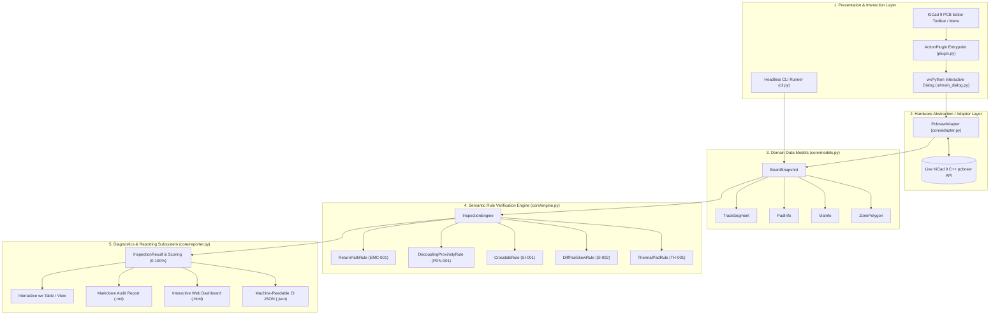
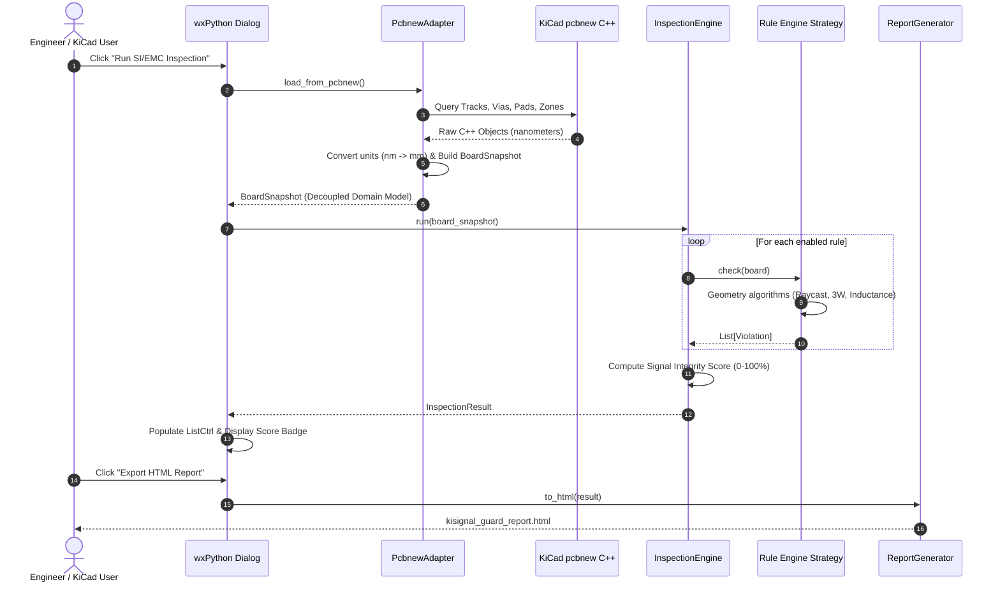

# KiSignal-Guard: Software Architecture & Design Document (SDD)
**Intelligent High-Speed Signal Integrity (SI), EMC & Power Decoupling Linter for KiCad 9**  
*FOSSEE eSim Semester Long Internship 2026 — Task 6*

---

## 1. Executive Summary & Problem Statement

### 1.1 Motivation
In printed circuit board (PCB) design, standard automated Design Rule Checks (DRC) built into tools like KiCad primarily enforce **static physical clearances** (e.g., minimum trace spacing $> 0.2\text{ mm}$, minimum annular ring $> 0.15\text{ mm}$). 

However, modern mixed-signal, IoT, and high-speed embedded systems frequently fail due to **semantic electrical design flaws** that violate electromagnetic compatibility (EMC) and signal integrity (SI) principles:
1. **Return Path Discontinuities:** High-speed traces routed across split power/ground planes or copper voids force return currents to detour, creating massive current loops that radiate electromagnetic interference (EMI) and induce ground bounce.
2. **PDN Decoupling Bottlenecks:** Bypass capacitors placed far from IC power pins introduce parasitic trace inductance ($\approx 0.85\text{ nH/mm}$), collapsing power rail stability during high-speed CMOS switching transients ($V = L \cdot \frac{di}{dt}$).
3. **Crosstalk Violations (3W Rule):** Long parallel adjacent traces on the same layer create capacitive and inductive coupling, corrupting sensitive analog and digital signals.
4. **Differential Pair Phase Skew:** Length mismatches in differential pairs (USB, Ethernet, CAN) lead to differential-to-common-mode noise conversion.
5. **Thermal Dissipation Deficits:** Exposed thermal ground pads (EPADs) on power regulators lacking sufficient thermal via matrices, causing thermal throttling or field failures.

### 1.2 The KiSignal-Guard Solution
**KiSignal-Guard** is an open-source, extensible KiCad 9 plugin that automates semantic layout verification. It synthesizes core Computer Science concepts (computational geometry, graph traversal, decoupled domain architecture, rule-visitor patterns) with electrical engineering fundamentals to provide interactive visual diagnostics, layout scoring (0–100%), actionable engineering recommendations, and headless CI/CD capability.

---

## 2. High-Level Architectural Design

KiSignal-Guard follows a clean, layered architectural pattern (Hexagonal / Ports-and-Adapters) ensuring that the core physical rules and mathematical calculations remain completely decoupled from KiCad's C++ GUI framework and `pcbnew` Python API.



---

## 3. Module Breakdown & Component Descriptions

| Module | Purpose | Key Classes & Functions |
| :--- | :--- | :--- |
| `kisignal_guard.plugin` | Integrates with KiCad 9 ActionPlugin lifecycle | `KiSignalGuardAction`, `defaults()`, `Run()` |
| `kisignal_guard.metadata.json` | KiCad 9 Plugin and Content Manager (PCM) specification | Schema v1, packaging metadata, platform support |
| `kisignal_guard.core.models` | Pure Python dataclasses representing PCB entities & results | `Point2D`, `TrackSegment`, `PadInfo`, `ZonePolygon`, `Violation`, `InspectionResult` |
| `kisignal_guard.core.geometry` | 2D computational geometry engine without external dependencies | `point_in_polygon`, `segments_intersect`, `parallel_overlap_length`, `segment_to_segment_distance` |
| `kisignal_guard.core.adapter` | Bridges live KiCad `pcbnew` objects to domain entities; handles nanometer conversion ($10^6\text{ nm} = 1\text{ mm}$) | `PcbnewAdapter.load_from_pcbnew()` |
| `kisignal_guard.core.rules.*` | Semantic verification algorithms implementing `BaseRule` | `ReturnPathRule`, `DecouplingProximityRule`, `CrosstalkRule`, `DiffPairSkewRule`, `ThermalPadRule` |
| `kisignal_guard.core.engine` | Orchestrates audit execution, time profiling, and overall scoring | `InspectionEngine.run()` |
| `kisignal_guard.core.reporter` | Formats results into Markdown, JSON, and rich HTML | `ReportGenerator.to_html()`, `to_markdown()`, `to_json()` |
| `kisignal_guard.ui.main_dialog` | Native wxPython GUI with rule toggles, diagnostics grid, and export | `KiSignalGuardDialog` |
| `kisignal_guard.cli` | Standalone CLI entrypoint for headless environments and CI/CD | `python -m kisignal_guard.cli` |

---

## 4. Electrical Engineering Theory & Mathematical Formulations

### 4.1 Return Current Path & Split-Plane Crossing
High-speed signal currents return to their source along the path of least **impedance** ($Z = R + j\omega L$). At frequencies $f > 100\text{ kHz}$, the inductive reactance dominates ($\omega L \gg R$), forcing return currents to concentrate directly underneath the active signal trace in the adjacent ground plane.
When a trace crosses a gap or split plane:
$$\Delta V_{ground\_bounce} = L_{loop} \cdot \frac{di}{dt}$$
The detoured return current dramatically increases loop area $A$, and radiated electric field $E$ scales with loop area:
$$E_{radiated} \propto f^2 \cdot I \cdot A$$
**KiSignal-Guard Implementation:** The `ReturnPathRule` interpolates coordinate samples along every critical signal segment and verifies reference ground polygon enclosure using ray-casting.

### 4.2 Power Distribution Network (PDN) & Decoupling Inductance
A bypass capacitor provides high-frequency charge during IC gate switching. The parasitic trace inductance of the connecting loop is approximately:
$$L_{trace} \approx 0.85\text{ nH/mm}$$
Total loop inductance includes power and ground returns ($L_{total} \approx 2 \cdot d \cdot L_{trace}$). For a 10 mm trace, $L_{total} \approx 17\text{ nH}$. At $100\text{ MHz}$, this adds:
$$X_L = 2\pi f L \approx 2 \cdot \pi \cdot 10^8 \cdot 17 \cdot 10^{-9} \approx 10.7\ \Omega$$
This impedance prevents the capacitor from suppressing voltage transients.
**KiSignal-Guard Implementation:** `DecouplingProximityRule` searches the IC-to-capacitor Euclidean distance and flags violations when distance exceeds $3.5\text{ mm}$ (Warning) or $6.0\text{ mm}$ (Error).

### 4.3 Crosstalk & The 3W Spacing Rule
Near-end crosstalk (NEXT) and far-end crosstalk (FEXT) arise from mutual inductance ($L_m$) and mutual capacitance ($C_m$) between adjacent parallel conductors:
$$V_{NEXT} \approx K_{ne} \cdot \frac{L_{overlap}}{t_r}$$
To maintain mutual coupling below $-20\text{ dB}$, the empirical **3W rule** requires:
$$S_{center-to-center} \ge 3 \cdot W \iff S_{edge-to-edge} \ge 2 \cdot W$$
**KiSignal-Guard Implementation:** `CrosstalkRule` extracts parallel vectors, tests directional alignment ($\theta \le 7.5^\circ$), projects orthogonal overlap length, and verifies edge-to-edge clearance.

### 4.4 Differential Pair Length Matching & Phase Skew
Signal velocity in standard FR4 microstrip is:
$$v = \frac{c}{\sqrt{\epsilon_{r,eff}}} \approx \frac{3 \times 10^8\text{ m/s}}{\sqrt{3.0}} \approx 1.73 \times 10^8\text{ m/s} \implies \tau_{prop} \approx 6.2\text{ ps/mm}$$
A trace length delta $\Delta L = 2.0\text{ mm}$ introduces a skew of $\approx 12.4\text{ ps}$, shifting the differential zero-crossing and causing common-mode radiation.
**KiSignal-Guard Implementation:** `DiffPairSkewRule` detects differential nets via regex (`*_P/*_N` and `*+/*-`), evaluates length deltas, and computes phase skew in picoseconds.

---

## 5. Computer Science Concepts & Algorithmic Design



### 5.1 Computational Geometry: Point-in-Polygon Ray Casting
KiSignal-Guard uses the Jordan Curve Theorem (even-odd crossing count). A horizontal ray from point $(x, y)$ to $(+\infty, y)$ is tested against every polygon edge $(p_1, p_2)$:
$$x_{intersection} = \frac{(y - p_1.y)(p_2.x - p_1.x)}{p_2.y - p_1.y} + p_1.x$$
- **Time Complexity:** $O(V)$ per test, where $V$ is the number of polygon vertices.
- **Robustness:** Handles horizontal collinear edge degeneracies with epsilon guards ($10^{-12}$).

### 5.2 Parallel Segment Overlap via Vector Projection
To compute coupling length between two segments $AB$ and $CD$:
1. Form unit direction vector $\hat{u} = \frac{B - A}{\|B - A\|}$.
2. Project $C$ and $D$ onto the line defined by $AB$:
   $$t_C = (C - A) \cdot \hat{u}, \quad t_D = (D - A) \cdot \hat{u}$$
3. Overlap is the intersection between intervals $[0, \|AB\|]$ and $[\min(t_C, t_D), \max(t_C, t_D)]$.

---

## 6. Execution Instructions & Installation Guide

### 6.1 Installation into KiCad 9
1. Locate your KiCad 9 scripting directory:
   - **Windows:** `%APPDATA%\kicad\9.0\scripting\plugins\` (or `plugins3\`)
   - **Linux:** `~/.local/share/kicad/9.0/scripting/plugins/`
   - **macOS:** `~/Library/Preferences/kicad/9.0/scripting/plugins/`
2. Copy the `kisignal_guard` folder into the plugins directory.
3. In KiCad PCB Editor (`pcbnew`):
   - Navigate to **Tools** $\rightarrow$ **External Plugins** $\rightarrow$ **Refresh Plugins**.
   - The **KiSignal-Guard** icon appears on the top toolbar.

### 6.2 Running Standalone CLI / Headless Linting
You can run KiSignal-Guard outside KiCad in any standard Python environment:
```powershell
# Run synthetic benchmark demo
python -m kisignal_guard.cli --demo

# Run audit and export HTML, Markdown, and JSON reports
python -m kisignal_guard.cli --demo --output-html report.html --output-md report.md --output-json report.json

# Run on an existing KiCad 9 board file
python -m kisignal_guard.cli --kicad-pcb "path/to/board.kicad_pcb" --min-score 80.0
```

### 6.3 Running Automated Unit Tests
```powershell
python -m unittest discover -s tests -v
```

---

## 7. Future Roadmap for Internship Period

During the semester-long internship, the plugin can be expanded with the following planned milestones:
1. **Automated Layout Remediation / Healing:**
   - Automatic insertion of thermal via grids with customizable pitch and drill sizes.
   - Automatic generation of ground return stitching vias adjacent to layer transitions.
2. **2D Finite Element Method (FEM) Ground Impedance Solver:**
   - Solving Laplace's equation for voltage and return current distribution across non-trivial plane shapes.
3. **Deep Integration with eSim:**
   - Direct cross-probing between schematic netlists in eSim and layout geometries in KiCad.
